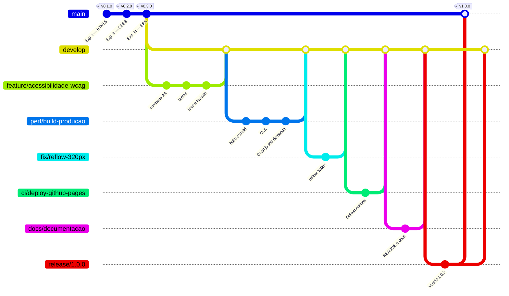

# 🌱 Instituto Semear Futuro

Plataforma web do **Instituto Semear Futuro**, uma ONG fictícia que atua com educação, segurança alimentar e inclusão digital. O site divulga os projetos sociais, capta doações e cadastra voluntários.

Projeto desenvolvido nas Experiências Práticas I a IV da disciplina **Desenvolvimento Front-end**.

- **Site publicado:** https://pedro03072.github.io/instituto-semear-futuro/
- **Repositório:** https://github.com/pedro03072/instituto-semear-futuro
- **Autor:** Pedro Henrique Barcante Santana

---

## Sumário

1. [Funcionalidades](#funcionalidades)
2. [Tecnologias](#tecnologias)
3. [Estrutura de pastas](#estrutura-de-pastas)
4. [Instalação e uso](#instalação-e-uso)
5. [Build de produção](#build-de-produção)
6. [Testes e validação](#testes-e-validação)
7. [Deploy](#deploy)
8. [Acessibilidade (WCAG 2.1 AA)](#acessibilidade-wcag-21-aa)
9. [Performance](#performance)
10. [Fluxo de trabalho com Git (GitFlow)](#fluxo-de-trabalho-com-git-gitflow)
11. [Manutenção](#manutenção)
12. [Licença](#licença)

---

## Funcionalidades

| Tela | Rota | O que faz |
|---|---|---|
| Início | `#/` | Apresentação da ONG, missão, visão e valores, números de impacto animados e projetos em destaque |
| Projetos | `#/projetos` | Lista gerada a partir de dados, com filtro por categoria e busca (o filtro fica na URL) |
| Detalhe | `#/projetos/:id` | Página de cada projeto, com vagas para voluntários e atalho para o cadastro |
| Cadastro | `#/cadastro` | Formulário de voluntários e doadores com máscaras, validação, preenchimento automático do endereço pelo CEP e rascunho salvo |
| Painel | `#/painel` | Cadastros salvos no navegador, com estatísticas, gráfico, filtros e exclusão |

Recursos gerais: navegação sem recarregar a página (SPA), menu responsivo com submenu e hambúrguer, **modo escuro** e **alto contraste**, toasts e modal de confirmação.

## Tecnologias

- **HTML5 semântico:** `header`, `nav`, `main`, `section`, `article`, `figure`, `dialog` e outros.
- **CSS3:** Design System com variáveis, grid de 12 colunas, Flexbox, 5 breakpoints e nomenclatura BEM.
- **JavaScript (ES2019+):** sem framework, com código modular em namespace (`window.ONG`).
- **localStorage:** persistência dos cadastros, do rascunho e do tema escolhido.
- **Chart.js 4.5** (MIT): gráfico do painel, carregado sob demanda.
- **API ViaCEP:** busca do endereço pelo CEP.
- **esbuild, html-minifier-terser e SVGO:** build de produção (minificação e junção de arquivos, otimização de SVG).
- **GitHub Actions + GitHub Pages:** deploy automático.

## Estrutura de pastas

```
instituto-semear-futuro/
├── index.html                 → atalho: redireciona para html/index.html
├── html/
│   └── index.html             → casca da SPA (cabeçalho, <main id="app">, rodapé, toast, modal)
├── css/
│   ├── style.css              → importa as camadas abaixo, nesta ordem
│   ├── 01-variaveis.css       → Design System (cores, tipografia, espaçamentos, breakpoints)
│   ├── 02-base.css            → reset e estilos globais
│   ├── 03-layout.css          → container, grid de 12 colunas, cabeçalho e rodapé
│   ├── 04-componentes.css     → botões, cartões, menu, badges, alertas, formulário, modal, toast
│   ├── 05-utilitarios.css     → classes utilitárias
│   ├── 06-aplicacao.css       → estados da SPA (validação, filtros, transições)
│   └── 07-temas.css           → modo escuro e alto contraste
├── js/
│   ├── app.js                 → ponto de entrada: registra as rotas e inicia os componentes
│   ├── core/                  → dom.js, storage.js, router.js (infraestrutura)
│   ├── data/                  → projetos.js (dados e rótulos)
│   ├── components/            → menu.js, modal.js, toast.js, tema.js
│   ├── templates/             → HTML de cada tela (funções puras)
│   ├── features/              → comportamento: validação, máscaras, CEP, cadastro, projetos, painel
│   └── lib/                   → chart.umd.min.js (biblioteca externa)
├── imagens/                   → logotipo e ilustração (SVG, WebP, PNG, JPG)
├── docs/
│   └── acessibilidade.md      → relatório de auditoria WCAG 2.1 AA
├── .github/workflows/
│   └── deploy.yml             → build + deploy automático no GitHub Pages
├── build.js                   → script de build de produção
├── package.json
├── CHANGELOG.md · CONTRIBUTING.md · LICENSE
└── dist/                      → gerado pelo build (não versionado)
```

## Instalação e uso

**Pré-requisitos:** um navegador atualizado. Para o build, também é preciso ter o [Node.js 18+](https://nodejs.org).

```bash
# 1. Clonar o repositório
git clone https://github.com/pedro03072/instituto-semear-futuro.git
cd instituto-semear-futuro

# 2. Instalar as dependências de desenvolvimento (apenas o esbuild)
npm install

# 3. Rodar em modo de desenvolvimento (abre o navegador em /html/index.html)
npm run dev
```

> Sem Node.js também funciona: basta abrir o arquivo `index.html` com dois cliques. Os scripts foram organizados para rodar direto do disco, sem servidor.

**Como usar:**
1. Em **Projetos**, filtre por categoria ou busque por palavra-chave.
2. Em **Seja voluntário**, preencha o cadastro. Digite o CEP para o endereço ser preenchido automaticamente.
3. Em **Painel**, veja os cadastros salvos, filtre ou exclua.
4. Use os botões ☾ (modo escuro) e ◐ (alto contraste) no menu. A escolha fica salva.

## Build de produção

```bash
npm run build     # gera a pasta dist/
npm run preview   # gera o build e abre em um servidor local
```

O `build.js`:

| Etapa | Ferramenta | Antes | Depois |
|---|---|---|---|
| HTML | html-minifier-terser | 7,1 KB | 4,6 KB (**−34%**) |
| CSS | esbuild (junta os `@import` e minifica) | 8 arquivos, 37,9 KB | 1 arquivo, 27,0 KB (**−29%**) |
| JavaScript | esbuild (junta na ordem de dependência e minifica) | 21 arquivos, 78,3 KB | 2 arquivos, 53,8 KB (**−31%**) |
| Imagens | SVGO (SVG) + PNG em paleta de 64 cores | 38,4 KB | 20,5 KB (**−47%**) |
| Requisições iniciais | — | 29 arquivos | 4 arquivos |

O Chart.js (208 KB) fica fora do pacote principal e só é baixado quando o usuário abre o Painel.

## Testes e validação

Antes de cada pull request, rode a versão de produção e siga o roteiro abaixo:

```bash
npm run build      # o build precisa terminar sem erros
npm run preview    # abre dist/ em http://localhost:8080
```

| Tipo | Ferramenta | Critério de aprovação |
|---|---|---|
| HTML e CSS | [W3C Validator](https://validator.w3.org/) (arquivo `html/index.html` e HTML de cada tela, via DevTools → Copy outerHTML) | 0 erros |
| Acessibilidade | Extensão **axe DevTools** em cada tela, nos 3 temas | 0 violações |
| Qualidade geral | **Lighthouse** (DevTools → Lighthouse) | Acessibilidade 100; Performance ≥ 90 |
| Teclado | Navegação só com Tab, Shift+Tab, Enter e Esc | Todo controle alcançável e com foco visível |
| Responsividade | DevTools → modo dispositivo em 320, 375, 768, 1024 e 1280 px | Sem rolagem horizontal |
| Funcional | Roteiro manual | Veja abaixo |

**Roteiro funcional:**
1. Navegar pelas 5 rotas pelo menu e pelo botão voltar do navegador; um endereço inexistente mostra a página 404.
2. Filtrar projetos por categoria e buscar "horta" → 1 resultado.
3. Enviar o cadastro vazio → resumo de erros com links; CPF `111.111.111-11` → "CPF inválido".
4. Cadastro válido → toast de sucesso e redirecionamento ao Painel; recarregar a página → o cadastro continua lá.
5. Repetir o mesmo e-mail → "Já existe um cadastro com este e-mail".
6. Digitar um CEP real → endereço preenchido; com a rede desligada (DevTools → Network → Offline) → aviso para preencher manualmente.
7. Console do navegador sem erros em todas as telas.

## Deploy

O deploy é automático pelo **GitHub Actions** (`.github/workflows/deploy.yml`): a cada `push` na branch `main`, o workflow instala as dependências, roda `npm run build` e publica a pasta `dist/` no **GitHub Pages**.

Configuração única no GitHub: **Settings → Pages → Build and deployment → Source: GitHub Actions**.

## Acessibilidade (WCAG 2.1 AA)

A auditoria completa está em [`docs/acessibilidade.md`](docs/acessibilidade.md). Resumo:

- **axe-core 4.13:** 0 violações nas 6 telas × 3 temas (18 auditorias), regras `wcag2a`, `wcag2aa`, `wcag21a`, `wcag21aa` e `best-practice`.
- **Lighthouse:** Acessibilidade 100.
- **Contraste:** todas as combinações de texto ≥ 4,5:1 (texto principal 14,9:1).
- **Teclado:** link "Pular para o conteúdo", ordem de foco lógica, submenu por teclado, Esc fecha menu e modal, foco visível.
- **Leitores de tela:** landmarks, `aria-current`, `aria-expanded`, `aria-invalid`, mensagens de erro ligadas por `aria-describedby`, `aria-live` nos avisos e foco levado ao título ao trocar de tela.
- **Preferências:** modo escuro, alto contraste e respeito a `prefers-reduced-motion` e `prefers-color-scheme`.

## Performance

Resultado do Lighthouse na versão de produção (página inicial):

| Performance | Acessibilidade | Boas práticas | SEO |
|:-:|:-:|:-:|:-:|
| 98 | 100 | 100 | 100 |

FCP de 1,1 s, LCP de 1,7 s, CLS de 0,07 e TBT de 80 ms, com **88 KB transferidos** no total (medição com simulação de celular em rede 4G lenta; a nota de performance varia entre 98 e 99 de uma execução para outra).

Otimizações aplicadas:
- minificação de HTML, CSS e JS e junção de 29 arquivos em 4;
- Chart.js (208 KB) carregado sob demanda, só no Painel;
- imagens em SVG (vetorial, otimizado com SVGO), com WebP e PNG em paleta como alternativas, via `<picture>`;
- `width`/`height` nas imagens e altura reservada para a área principal (CLS de 0,83 → 0,07);
- `loading="lazy"` na ilustração e `defer` nos scripts.

## Fluxo de trabalho com Git (GitFlow)



| Branch | Função | Sai de | Volta para |
|---|---|---|---|
| `main` | Código em produção; cada merge gera uma tag de versão e dispara o deploy | — | — |
| `develop` | Integração das funcionalidades prontas para a próxima versão | `main` | — |
| `feature/*`, `fix/*`, `perf/*`, `ci/*`, `docs/*` | Uma tarefa por branch | `develop` | `develop` (pull request) |
| `release/x.y.z` | Preparação da versão: número, changelog, ajustes finais | `develop` | `main` **e** `develop` |
| `hotfix/x.y.z` | Correção urgente em produção | `main` | `main` **e** `develop` |

- Toda integração é feita por **pull request** com revisão e merge sem fast-forward (`--no-ff`), preservando no histórico o que pertence a cada tarefa.
- **Commits semânticos** ([Conventional Commits](https://www.conventionalcommits.org/pt-br/)): `tipo(escopo): descrição no imperativo`, com tipos `feat`, `fix`, `perf`, `docs`, `build`, `ci`, `refactor`, `chore`.
- **Versões** seguem o [SemVer](https://semver.org/lang/pt-BR/), com tags anotadas na `main` e registro no [`CHANGELOG.md`](CHANGELOG.md).

Passo a passo em [`CONTRIBUTING.md`](CONTRIBUTING.md).

## Manutenção

| Quero… | Onde alterar |
|---|---|
| Adicionar ou editar um projeto | `js/data/projetos.js`: basta incluir um objeto no array |
| Mudar cores, fontes ou espaçamentos | `css/01-variaveis.css` (tokens do Design System) |
| Ajustar cores do modo escuro/alto contraste | `css/07-temas.css` |
| Criar uma nova tela | Template em `js/templates/`, comportamento em `js/features/`, rota em `js/app.js` e `<script>` em `html/index.html` |
| Trocar o localStorage por uma API real | Apenas `js/core/storage.js` (os demais módulos usam só a sua interface) |
| Mudar regras de validação | `js/features/validacao.js` (gerais) e `js/features/cadastro.js` (consistência) |

Sempre que alterar a lista de scripts do `html/index.html`, mantenha a ordem de dependência: `core → data → components → templates → features → app.js`. O build segue essa mesma ordem.

## Licença

Distribuído sob a licença MIT. Veja [`LICENSE`](LICENSE). O Chart.js também é MIT. A organização, os dados e os depoimentos são fictícios, para fins acadêmicos.
